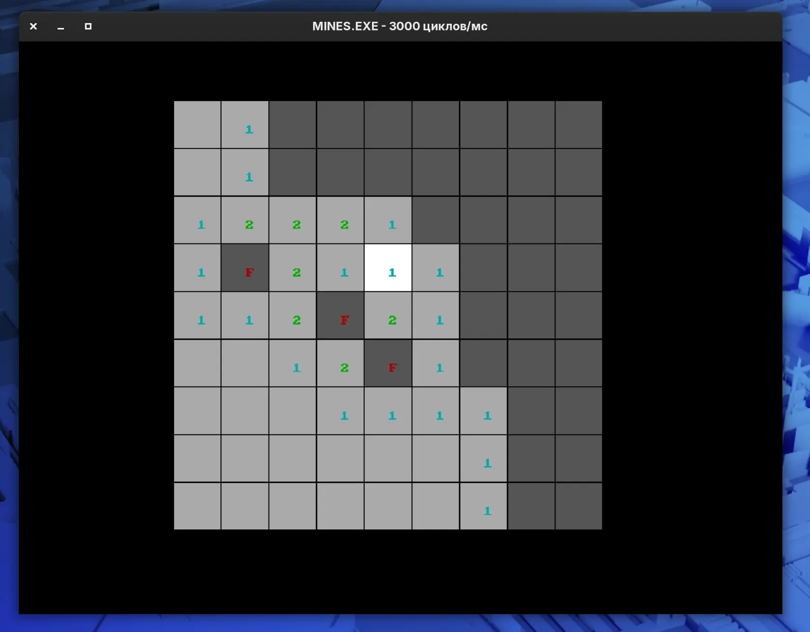

# Minesweeper for DOS

Simple Minesweeper for DOS. Built with open watcom.

Check `build.sh` and `setvars.sh` and make appropriate edits
to them depending on how your system is set up.

However the exe file is included, so you don't have to
go through that pain.

## Screenshot

## Controls

- arrow keys - move around
- enter - open the cell
- f - toggle flag
- 1, 2, 3 - select difficulty level (after restart)
- n - restart the game
- esc - exit
